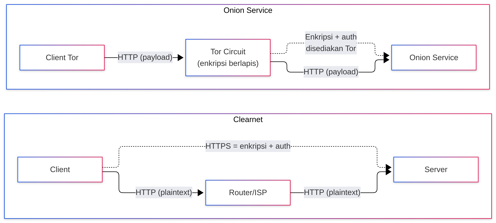
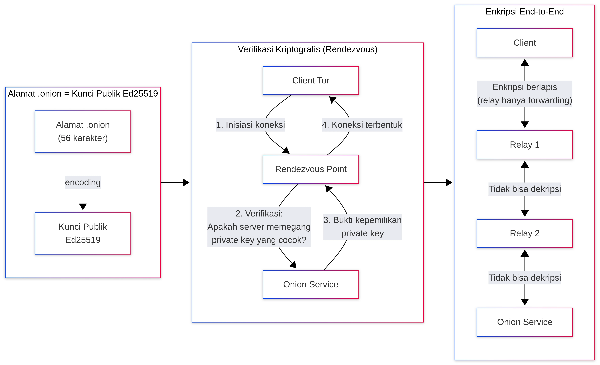
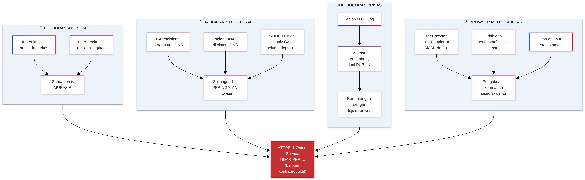
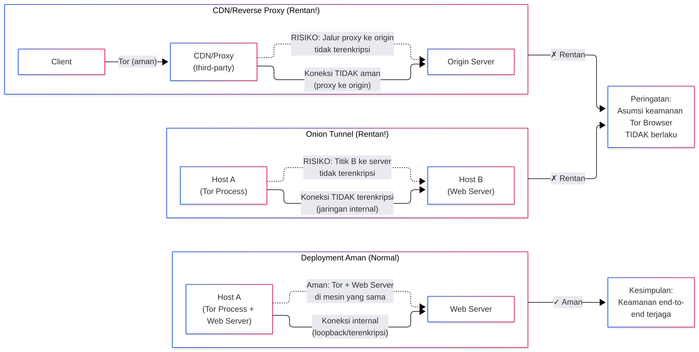

_Perbandingan arsitektur keamanan HTTP di Clearnet vs Onion Service_

Dalam arsitektur jaringan modern, "HTTP" hanyalah protokol lapisan aplikasi, tingkat keamanannya sepenuhnya bergantung pada protokol transportasi di bawahnya. Di Clearnet, HTTP telanjang berarti teks polos, tanpa enkripsi dan tanpa autentikasi, namun di Onion Service, meskipun skema yang sama digunakan, lapisan bawahnya telah disediakan oleh jaringan Tor dengan enkripsi end-to-end dan autentikasi mandiri berbasis kriptografi kunci publik. Perbedaan ini berasal dari fakta bahwa Onion Service memigrasikan jaminan keamanan dari lapisan aplikasi (HTTPS/TLS) ke lapisan jaringan (Tor), sehingga HTTP "tidak perlu" dan "tidak seharusnya" untuk menambahkan HTTPS secara paksa dalam sebagian besar skenario.

### 1. Keamanan HTTP di Clearnet

Di Clearnet (jaringan internet publik biasa), ketika Anda mengakses `http://example.com`, lalu lintas data ditransmisikan dalam teks polos melalui rantai routing yang tidak terpercaya. Ini berarti:

- Setiap node di jalur (router Wi-Fi, ISP, node transit) dapat menyadap dan membaca konten sepenuhnya.
- Pihak tengah dapat menyisipkan atau memodifikasi konten halaman tanpa sepengetahuan pengguna.
- Pengguna tidak dapat memverifikasi apakah server yang terhubung adalah tujuan yang sebenarnya, rentan terhadap spoofing DNS atau serangan pembajakan.

Dalam skenario ini, HTTPS adalah satu-satunya sarana untuk menambal celah-celah ini. HTTPS menambahkan lapisan TLS antara HTTP dan TCP, menyediakan enkripsi, verifikasi integritas, dan (melalui rantai sertifikat CA) autentikasi server. Oleh karena itu, "HTTP di Clearnet tidak aman" adalah proposisi yang benar, karena lapisan bawahnya (TCP/IP) tidak memiliki kemampuan keamanan apa pun.

### 2. Titik Fondasi Onion Service

Keamanan Onion Service tidak berasal dari protokol lapisan aplikasi, melainkan dibangun ke dalam mekanisme pengalamatan dan routing.

_Fondasi keamanan Onion Service: alamat .onion sebagai kunci publik dan enkripsi end-to-end Tor circuit_

Alamat .onion adalah kunci publik. Alamat Onion versi 3 (56 karakter) bukanlah nama domain yang diberikan oleh otoritas pusat mana pun, melainkan representasi encoding dari kunci publik Ed25519. Ketika klien Tor menginisiasi koneksi, protokol Rendezvous memverifikasi secara kriptografis apakah pihak server memegang kunci privat yang sesuai dengan alamat tersebut. Ini berarti alamat itu sendiri adalah bukti identitas. Jika Anda memasukkan alamat yang benar, koneksi yang Anda bangun secara matematis terjamin hanya dapat mencapai pemegang kunci privat tersebut, tidak ada "pihak tengah" yang dapat menyamar.

Tor circuit menyediakan enkripsi end-to-end. Lalu lintas dari klien ke Onion Service sepenuhnya ditransmisikan di dalam jaringan Tor, tidak keluar melalui exit node. Data dienkripsi berlapis-lapis antara klien dan layanan, dan node relay perantara hanya bertanggung jawab untuk forwarding, tidak dapat mendekripsi konten. Tor Project secara eksplisit menyatakan bahwa Onion Service sudah menyediakan enkripsi dan autentikasi end-to-end, bahkan jika lapisan aplikasi menggunakan HTTP biasa, tidak rentan terhadap man-in-the-middle atau penyadapan.

Dalam koneksi Onion, "HTTP" hanyalah payload yang dibawa di dalam saluran terenkripsi. Sama seperti Anda menjalankan HTTP melalui SSH tunnel atau VPN, keamanan disediakan oleh protokol transportasi (Tor), bukan oleh HTTP itu sendiri.

### 3. Mengapa Onion Service "Tidak Perlu" HTTPS

Jika Tor sudah menyediakan enkripsi dan autentikasi, menambahkan TLS/HTTPS di atasnya secara teori adalah redundansi fungsi. Namun alasan untuk tidak melakukannya lebih dari sekadar "mubazir":

Pertama, memperoleh sertifikat HTTPS yang dipercaya publik untuk alamat .onion memiliki hambatan struktural. Sertifikat CA tradisional bergantung pada sistem DNS dan validasi HTTP/DNS, sedangkan ruang alamat .onion tidak berada dalam sistem DNS. Meskipun ada proposal seperti SOOC (Same Origin Onion Certificates) atau Onion-only CA yang mencoba menyelesaikan masalah ini, hingga saat ini adopsi yang meluas masih menghadapi kesulitan. Jika operator memaksa menggunakan sertifikat yang ditandatangani sendiri, browser akan memunculkan peringatan, merusak pengalaman.

Kedua, penandatanganan sertifikat dapat membocorkan privasi. Jika alamat .onion dimasukkan ke dalam Certificate Transparency Log (CT Log), maka alamat tersembunyi yang seharusnya hanya diketahui oleh pihak-pihak yang berkepentingan akan menjadi publik. Bertentangan dengan tujuan privasi Onion Service.

Ketiga, browser telah menyesuaikan perilakunya. Tor Browser memperlakukan koneksi HTTP ke alamat .onion sebagai "aman secara default", tidak menampilkan peringatan "tidak aman", dan ikon onion di bilah alamat juga akan menunjukkan status aman untuk HTTP. Ini bukan kelalaian, melainkan pengakuan atas fakta bahwa keamanan disediakan oleh Tor.

_Tiga alasan HTTPS tidak diperlukan di Onion Service_

### 4. Pengecualian dan Skenario Khusus

Perlu ditekankan bahwa keamanan Onion Service memiliki batas cakupan, dari Tor Browser hingga proses Tor di sisi server. Jika arsitektur deployment Onion Service adalah "onion tunnel" (yaitu proses Tor berada di host A, sementara server web sebenarnya berada di host B, dan koneksi antara A dan B tidak terenkripsi), maka keamanan dari titik B ke server web akan rusak. Tor Project pernah mengirim email peringatan yang secara eksplisit menyebutkan masalah ini, Tor Browser membuat asumsi keamanan berdasarkan premis bahwa koneksi internal Onion Service aman jika proses Tor dan server web tidak berada di mesin yang sama atau koneksinya tidak terenkripsi, maka asumsi tersebut tidak berlaku.

_Batas cakupan keamanan Onion Service_

Selain itu, jika Onion Service menggunakan CDN atau reverse proxy pihak ketiga sebagai frontend, dan jalur dari proxy ke server asal tidak aman, maka keamanan end-to-end juga akan terputus. Ini adalah jebakan implementasi, bukan cacat desain protokol.

### 5. Perbandingan Ringkas

| Dimensi | HTTP di Clearnet | HTTP di Onion Service |
|---------|------------------|----------------------|
| Kerahasiaan transmisi | Tidak ada (teks polos) | Ada (enkripsi Tor end-to-end) |
| Integritas | Tidak ada | Ada (jaminan Tor) |
| Autentikasi server | Tidak ada | Ada (verifikasi kriptografis alamat .onion) |
| Apakah HTTPS diperlukan | Harus | Tidak perlu (kecuali ada kebutuhan kompatibilitas khusus) |
| Vektor serangan utama | Penyadapan MITM, spoofing DNS | Keamanan internal deployment (onion tunnel), keamanan endpoint |

### Kesimpulan

Perbedaan keamanan antara HTTP di Clearnet dan HTTP di Onion Service, pada intinya adalah perbedaan arsitektur tentang siapa yang menyediakan jaminan keamanan. Clearnet menyerahkan keamanan ke lapisan aplikasi (HTTPS), sehingga HTTP telanjang berarti tanpa pertahanan. Onion Service memigrasikan keamanan ke lapisan jaringan (Tor), sehingga lapisan aplikasi dapat beroperasi dengan ringan. Memahami hal ini, ketika menghadapi alamat `.onion` yang diawali dengan `http://`, Anda tidak akan salah menganggapnya sebagai "tidak aman", juga tidak akan secara membabi buta percaya bahwa "Onion pasti aman" tanpa memeriksa keamanan koneksi internal deployment.