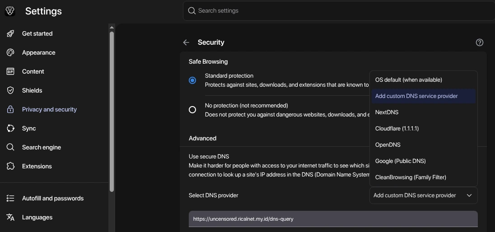
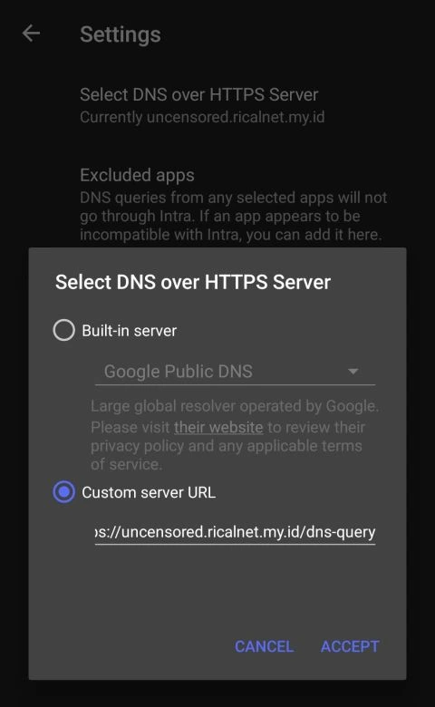
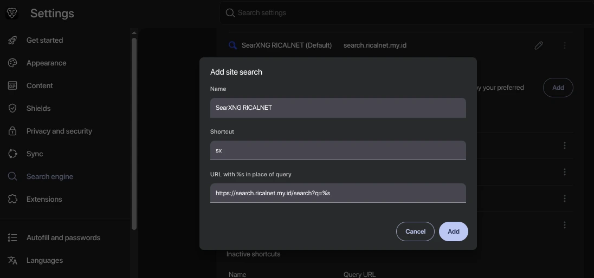
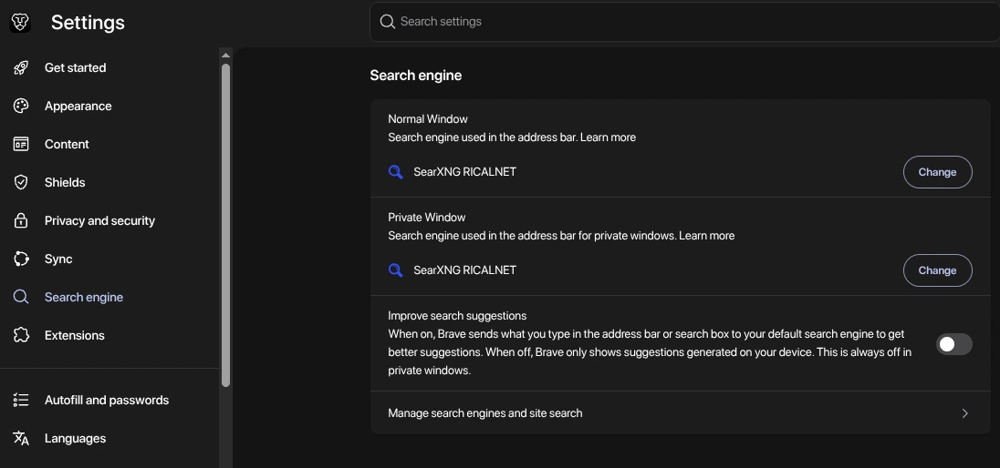

> Layanan ini ditujukan untuk mendukung kebebasan internet dengan menganut prinsip privacy-by-design, yaitu tidak mencatat log aktivitas, mampu memblokir iklan, serta memfilter domain berbahaya seperti phishing, malware, dan scam. 
{: .prompt-info}

> Karena bersifat privacy-focused, pengguna diharapkan tidak menyalahgunakan layanan ini untuk aktivitas ilegal. Segala bentuk penggunaan yang melanggar hukum sepenuhnya menjadi tanggung jawab pengguna masing-masing.
{: .prompt-danger}

## Pendahuluan

Akses internet yang bebas, aman, dan privat bukan lagi kemewahan melainkan kebutuhan dasar di era digital. Namun, banyak pengguna menghadapi tantangan berupa pemblokiran konten, pelacakan aktivitas, iklan intrusif, serta ancaman keamanan seperti phishing dan malware.

RICALNET menyediakan dua layanan untuk menjawab tantangan tersebut:

1. Resolver DNS yang tidak mencatat log, memblokir iklan, dan memfilter domain berbahaya.
2. Metasearch engine yang mengutamakan privasi dan bebas iklan pelacak.

Kedua layanan ini dirancang dengan prinsip zero-logging (tidak mencatat aktivitas pengguna) dan security filtering (memblokir iklan serta domain berbahaya). Artikel ini akan menjelaskan cara menggunakan keduanya, sekaligus alasan teknis di balik setiap langkah agar Anda tidak sekadar mengikuti instruksi, tetapi memahami mekanismenya.

## Bagian 1: DNS Server RICALNET

### Mengapa DNS?

DNS (Domain Name System) adalah "buku telepon" internet, ia menerjemahkan nama domain (misalnya `example.com`) menjadi alamat IP yang dapat dijangkau komputer. Setiap kali Anda membuka situs web, perangkat Anda mengirim kueri DNS ke resolver.

Masalahnya, resolver bawaan ISP umumnya:

- Mencatat log aktivitas Anda (situs apa yang dikunjungi, kapan, seberapa sering).
- Memblokir domain tertentu atas dasar kebijakan penyedia.
- Tidak memfilter domain berbahaya maupun domain periklanan, sehingga Anda rentan terhadap iklan, phishing, dan malware.

Dengan mengganti resolver DNS ke RICALNET, Anda memindahkan lapisan resolusi ke server yang:

- Tidak menyimpan log kueri.
- Memblokir domain iklan dan pelacak pada level DNS (sebelum koneksi ke server iklan terjadi).
- Memblokir domain phishing, malware, dan scam pada level DNS (sebelum koneksi ke server jahat terjadi).
- Tidak melakukan sensor terhadap konten.

### Hanya DNS-over-HTTPS (DoH)

Saat ini, RICALNET hanya menyediakan DNS-over-HTTPS (DoH). Ini keputusan desain yang disengaja:

- DoH mengenkripsi kueri DNS di dalam tunnel HTTPS (port 443), sehingga penyadap jaringan termasuk ISP atau operator Wi-Fi publik tidak dapat melihat domain apa yang Anda minta.
- DoH menyatu dengan trafik HTTPS biasa, sehingga sulit dibedakan dan diblokir oleh firewall yang melakukan deep packet inspection.
- DoH kompatibel dengan browser modern tanpa perlu instalasi perangkat lunak tambahan.

Konsekuensinya, Anda tidak bisa memakai RICALNET melalui DNS klasik (port 53) atau DNS-over-TLS (DoT).

### Konfigurasi per Platform

#### Chrome / Brave / Edge (Berbasis Chromium)

Browser berbasis Chromium memiliki fitur Secure DNS bawaan yang memungkinkan penggunaan DoH kustom.

Langkah:

1. Buka Settings.
2. Masuk ke Privacy and security → Security.
3. Gulir ke bagian Use secure DNS.
4. Pilih "Select DNS provider" → Add custom DNS service provider.
5. Masukkan URL: `https://uncensored.ricalnet.my.id/dns-query`
   

6. Simpan.

Mengapa langkah ini bekerja? Chromium akan mengirim semua kueri DNS melalui HTTPS ke endpoint tersebut, bukan melalui resolver sistem operasi. Artinya, bahkan jika ISP Anda memaksa resolver tertentu, browser Anda tetap menggunakan RICALNET selama trafik HTTPS tidak diblokir.

#### Firefox

Firefox memiliki fitur DNS over HTTPS yang dapat diaktifkan secara eksplisit.

Langkah:

1. Buka Settings → Privacy & Security.
2. Gulir ke bagian DNS over HTTPS.
3. Pilih Max Protection (agar Firefox hanya menggunakan DoH dan menolak fallback ke DNS biasa).
4. Pada Choose provider, pilih Custom.
5. Masukkan URL: `https://uncensored.ricalnet.my.id/dns-query`
6. Simpan.

Mengapa "Max Protection"? Mode ini mencegah Firefox diam-diam kembali ke DNS sistem jika DoH gagal, sehingga Anda tidak tanpa sadar bocor ke resolver ISP. Trade-off-nya, jika endpoint DoH tidak dapat dijangkau, resolusi DNS akan gagal. Untuk pengguna yang memprioritaskan privasi, ini pilihan yang tepat.

#### Android — Aplikasi Intra

Android (versi 9 ke atas) mendukung Private DNS native, tetapi hanya untuk DoT (DNS-over-TLS), bukan DoH. Karena RICALNET hanya menyediakan DoH, Anda perlu aplikasi pihak ketiga, seperti Intra.

Langkah:

1. Unduh Intra dari [Google Play Store](https://play.google.com/store/apps/details?id=app.intra&hl=en_US&pli=1) atau [F-Droid](https://f-droid.org/en/packages/app.intra/).
2. Buka aplikasi → Settings → Select DNS over HTTPS Server → Custom server URL.
3. Masukkan: `https://uncensored.ricalnet.my.id/dns-query`
   

4. Aktifkan koneksi Intra.

Mengapa Intra? Intra membangun VPN lokal (bukan VPN penuh) yang hanya membelokkan trafik DNS ke endpoint DoH pilihan Anda. Trafik lainnya tetap langsung. Ini cara paling bersih untuk memakai DoH kustom di Android tanpa mengubah seluruh routing perangkat.

## Bagian 2: SearXNG RICALNET

### Apa Itu SearXNG dan Mengapa Menggunakannya?

SearXNG adalah metasearch engine open-source yang menggabungkan hasil dari puluhan mesin pencari (Google, Bing, DuckDuckGo, dan lainnya) tanpa menyimpan profil pengguna, tanpa cookie pelacak, dan tanpa log kueri.

Instance RICALNET (`https://search.ricalnet.my.id`) adalah deployment SearXNG yang dihosting di infrastruktur RICALNET, dengan kebijakan:

- Tidak mencatat log kueri pencarian.
- Tidak membuat profil pengguna.
- Tidak mengirim data identitas Anda ke mesin pencari upstream (SearXNG menganonimkan permintaan).
- Menyaring hasil dan domain periklanan/pelacak dari sumber upstream.

Mengapa metasearch? Alih-alih mempercayai satu mesin pencari yang menyimpan riwayat Anda, SearXNG bertindak sebagai perantara, ia mengirim kueri Anda ke banyak sumber secara anonim, lalu menggabungkan hasilnya. Mesin pencari upstream hanya melihat permintaan dari server SearXNG, bukan dari Anda.

### Mengakses SearXNG RICALNET

Cukup kunjungi:

```
https://search.ricalnet.my.id
```

Tidak perlu registrasi, tidak perlu login. Semua fitur pencarian langsung tersedia.

### Menjadikan SearXNG RICALNET sebagai Search Engine Default

Agar setiap pencarian dari address bar browser otomatis diarahkan ke SearXNG RICALNET, Anda perlu menambahkan search engine kustom.

#### Chrome / Brave / Edge (Berbasis Chromium)

Langkah:

1. Buka Settings → Search engine → Manage search engines and site search.
2. Pada bagian Site search, klik Add.
3. Isi formulir:
   
   - Name: `SearXNG RICALNET`
   - Shortcut: bebas (misalnya `sx`) atau kosongkan.
   - URL with %s in place of query: `https://search.ricalnet.my.id/search?q=%s`

4. Simpan.
5. (Opsional) Jadikan default.
   

Mengapa `%s`? Placeholder `%s` adalah konvensi Chromium, browser akan mengganti `%s` dengan kata kunci yang Anda ketik. Tanpa placeholder ini, browser tidak dapat meneruskan kueri ke SearXNG. Parameter `q` adalah parameter standar SearXNG untuk kueri pencarian.

## Ringkasan Alur Teknis

| Layanan | Protokol | Endpoint | Manfaat Utama |
|---|---|---|---|
| DNS RICALNET | DoH (HTTPS) | `https://uncensored.ricalnet.my.id/dns-query` | Resolusi tanpa log, blokir iklan/pelacak, phishing/malware/scam |
| SearXNG RICALNET | HTTPS | `https://search.ricalnet.my.id` | Pencarian anonim, tanpa profil pengguna, bebas iklan pelacak |

Prinsip desain yang konsisten di kedua layanan:

1. Tidak ada pencatatan aktivitas.
2. Semua trafik melalui HTTPS.
3. Domain berbahaya dan domain periklanan/pelacak diblokir di level DNS.
4. Tidak ada pemblokiran konten atas dasar kebijakan.

Dengan mengombinasikan DNS RICALNET dan SearXNG RICALNET, Anda membangun lapisan privasi di dua titik kritis, yaitu resolusi nama domain (DNS) dan pencarian informasi (search engine). Keduanya adalah titik di mana pelacakan dan sensor paling sering terjadi dan keduanya kini berada di bawah kendali Anda.